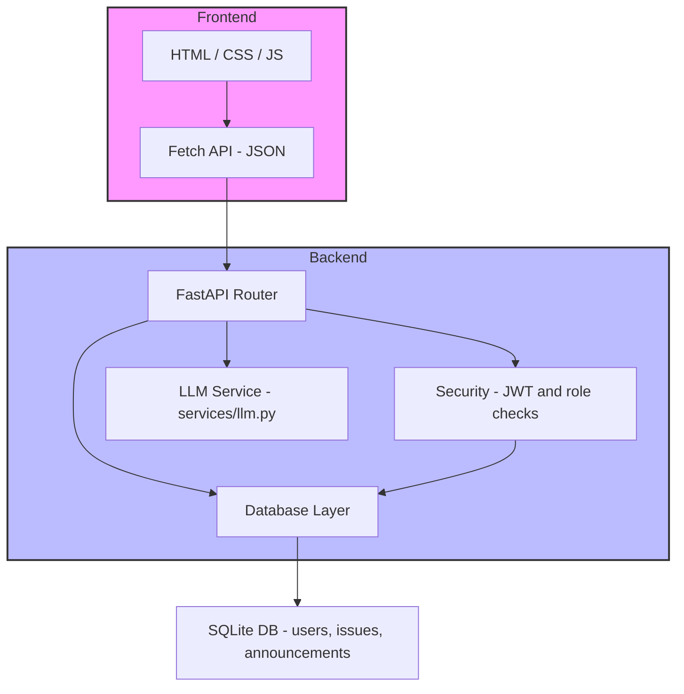

# Warden 📚

[](https://www.python.org/downloads/)
[](https://fastapi.tiangolo.com/) [](https://developer.mozilla.org/en-US/docs/Web/HTML) [](https://developer.mozilla.org/en-US/docs/Web/CSS)
[](LICENSE) [](https://developer.mozilla.org/en-US/docs/Web/JavaScript) [](https://www.json.org/json-en.html)

---
## Git Hub Repository Link

[Warden GitHub Repository](https://github.com/BhargavSharma7696/Warden)

---
## Table of Contents
- [Project Overview](#project-overview)
- [Features](#features)
- [Technologies Used](#technologies-used)
- [Architecture Diagram](#architecture-diagram)
- [Project Structure](#project-structure)
- [Installation & Setup](#installation--setup)
- [Running the Application](#running-the-application)
- [Usage Guide](#usage-guide)
- [Screenshots](#screenshots)
- [API Reference](#api-reference)
- [Database Schema](#database-schema)
- [Contributing](#contributing)
- [Future Improvements](#future-improvements)
- [License](#license)

---

## Project Overview
A lightweight **hostel‑management portal** built for the CSP‑203 computer‑science lab assignment. It combines **HTML**, **CSS**, **JSON**, and **JavaScript** on the front‑end with a **FastAPI**‑based Python back‑end. The system lets students and warden staff to register, raise issues, read/create announcements, and navigate a dashboard that showcases hostel information.

---

## Features

| ✅ | Feature |
|----|---------|
| 🔐 | Email‑based registration & JWT authentication |
| 👤 | Role‑based access (`student`, `warden`, `admin`) |
| 🐞 | Issue tracker (create, list, update status, delete) |
| 📢 | Announcements (list for all, create for warden/admin) |
| 📱 | Responsive UI built with vanilla **HTML**, **CSS**, and **JavaScript** |
| 📁 | SQLite persistence (auto‑created on first run) |
| ✅ | Front‑end validation (email format, required fields) |
| 🤖 | **Internal AI assistance** – the `services/llm.py` stub can extract summaries and details from free‑form announcement text using a language model (demonstrates AI integration). |

---

## Technologies Used

| Layer | Tools & Libraries |
|-------|-------------------|
| **Backend** | FastAPI, Pydantic, SQLite (`sqlite3`), `pwdlib` (argon2), PyJWT, `python-dotenv`, Uvicorn |
| **Frontend** | **HTML5**, **CSS3**, **JSON** (API payloads), **vanilla JavaScript** (ES6) |
| **AI / LLM** | `services/llm.py` – a placeholder that shows how an LLM could be called to extract a summary and structured details from announcement bodies |
| **Dev** | Python 3.14, virtualenv, Git |

---


## Architecture Diagram




---

## Project Structure
```
CSP-203-WebDev-Project/
├─ backend/                     # FastAPI server
│   ├─ routers/                # auth, issues, announcements
│   ├─ services/               # AI helper (LLM stub)
│   ├─ database.py
│   ├─ security.py
│   ├─ main.py
│   ├─ requirements.txt
│   └─ venv/                  # virtual environment (local)
├─ frontend/                    # Static client files
│   ├─ pages/                  # HTML pages (auth, dashboard, listissue, announcement, raiseissue, raiseannouncement, profile)
│   ├─ script/                 # Page‑specific JavaScript modules
│   ├─ styles/                 # CSS files (common, dashboard, listissue, announcement, raiseissue, etc.)
│   └─ cnt/                    # Images & icons
├─ hostel.db                    # SQLite DB (auto‑created)
├─ .env (optional)             # SECRET_KEY, DB_PATH
└─ README.md                    # This file
```
*Key files*:
- `backend/main.py` – FastAPI entry point, CORS, router inclusion.
- `backend/database.py` – `get_db()` and `init_db()` create the tables.
- `backend/security.py` – Password hashing, JWT creation/verification, role checks.
- `backend/routers/*.py` – API endpoints.
- `frontend/pages/*.html` – UI markup (HTML).  
- `frontend/styles/*.css` – Styling (CSS).  
- `frontend/script/*.js` – Client‑side logic, fetch calls, UI interaction, JSON handling.
- `backend/services/llm.py` – Demonstrates **internal AI** usage for summarising announcement bodies.

---

## Installation & Setup
1. **Clone** the repository
   ```bash
   git clone <repo‑url>
   cd CSP-203-WebDev-Project
   ```
2. **Create a virtual environment**
   ```bash
   python3 -m venv backend/venv
   source backend/venv/bin/activate
   ```
3. **Install dependencies**
   ```bash
   pip install -r backend/requirements.txt
   # optional – dotenv for environment variables
   pip install python-dotenv
   ```
4. **(Optional) Configure environment variables** – create a `.env` file in the project root:
   ```env
   SECRET_KEY="your‑random‑secret‑key"
   DB_PATH="backend/hostel.db"
   ```
   If omitted, defaults are used.
5. **Run the server** – see the next section.

---

## Running the Application
```bash
uvicorn backend.main:app --reload
```
The API will be reachable at **http://127.0.0.1:8000**.

Open any front‑end page in a browser, e.g.:
```
file:///home/ishan-ghatge/lab/assignments/CSP203%20web/CSP-203-WebDev-Project/frontend/pages/auth.html
```
The front‑end automatically contacts the backend on port 8000, so keep the server running.

---

## Usage Guide
| Step | Action |
|------|--------|
| **1️⃣ Register / Log in** | Open `auth.html`, supply e‑mail & password, click **Register** or **Log in**. JWT is stored in `localStorage`. |
| **2️⃣ Dashboard** | `dashboard.html` offers shortcuts to Issues, Announcements, and Profile. |
| **3️⃣ Raise Issue** | `raiseissue.html` – fill student details and description → submit → new row in `issues`. |
| **4️⃣ List Issues** | `listissue.html` – students see only their own tickets; warden/admin see all. Use filter tabs and view toggles. |
| **5️⃣ Announcements** | `announcement.html` – read all notices. If logged in as warden/admin, a **Raise Announcement** button appears (links to `raiseannouncement.html`). |
| **6️⃣ Create Announcement** | `raiseannouncement.html` – fill title, category, body, optional team/date → submit. The back‑end can invoke the **internal AI** (`services/llm.py`) to auto‑generate a summary and structured details if they are missing. |
| **7️⃣ Profile** | Placeholder page for future profile management. |

---

## API Reference
All routes (except `/auth/register` and `/auth/login`) require an `Authorization: Bearer <jwt>` header.

### Auth (`/auth`)
| Method | Endpoint | Description | Body | Returns |
|--------|----------|-------------|------|---------|
| POST | `/auth/register` | Register a new user | `{ "email": "…", "password": "…" }` | `{ "message": "User created" }` |
| POST | `/auth/login` | Authenticate and receive JWT | `{ "email": "…", "password": "…" }` | `{ "access_token": "…", "token_type": "bearer" }` |
| GET  | `/auth/me` | Current user details | – | User dict (`id`, `email`, `role`, …) |

### Issues (`/issues`)
| Method | Endpoint | Description | Body | Role |
|--------|----------|-------------|------|------|
| GET | `/issues` | List issues (filtered by role) | – | Authenticated |
| POST | `/issues` | Create a new issue | `IssueCreate` model | Authenticated |
| PATCH | `/issues/{id}/status` | Update status (`Pending` / `Resolved`) | `{ "status": "Resolved" }` | **warden**, **admin** |
| DELETE | `/issues/{id}` | Delete issue (owner or warden/admin) | – | Owner or **warden**, **admin** |

### Announcements (`/announcements`)
| Method | Endpoint | Description | Body | Role |
|--------|----------|-------------|------|------|
| GET | `/announcements` | List all announcements (newest first) | – | Authenticated |
| POST | `/announcements` | Create announcement (AI can autogenerate summary/details) | `AnnouncementCreate` model | **warden**, **admin** |

---

## Database Schema
Created by `backend/database.py` on first run.

### Tables
| Table | Columns (excerpt) | Notes |
|-------|-------------------|-------|
| **users** | `id` PK, `email` UNIQUE, `password_hash`, `role` (`student`/`warden`/`admin`) | Authentication & role control |
| **issues** | `id` PK, `user_id` FK → users.id, `email`, `student_id`, `student_name`, `room_number`, `hostel`, `phone`, `title`, `description`, `category`, `priority`, `summary`, `status`, `remarks`, `raised_on`, `resolved_on`, `created_at` | Issue tracking |
| **announcements** | `id` PK, `category`, `date`, `title`, `summary`, `team`, `body`, `details` (JSON), `created_at` | Public notices |
| **warden** | `main` TEXT (email format `CHECK`), `password` TEXT | Demo table used in early exercises – not part of the public API |

---


## License
This project is released under the **MIT License**. See the `LICENSE` file for details.
